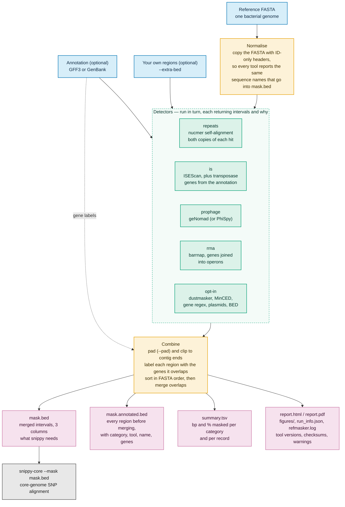

# refmasker

**Build a BED mask of problematic regions in a bacterial reference genome, for core-genome SNP
analysis with [snippy](https://github.com/tseemann/snippy).**

snippy ships a hand-curated mask for *M. tuberculosis* H37Rv, but not for the per-ST references used
for most other species. refmasker builds one from a reference FASTA. It finds repeats, insertion
sequences, prophages and rRNA operons, and optionally other region types. It writes a BED file for
`snippy --mask` / `snippy-core --mask` and a report showing what was masked, why, and how much of
the genome that is.

```
refmasker run reference.fna --annotation reference.gff -o reference_mask
snippy-core --ref reference.fna --mask reference_mask/mask.bed --prefix core isolate1 isolate2 ...
```

## What gets masked

| Category | Default | Found by | Why |
| --- | --- | --- | --- |
| `repeats` | on | nucmer self-alignment | Reads map to the wrong copy, giving false SNPs |
| `is` | on | ISEScan, plus transposase genes from the annotation | Multi-copy, mobile |
| `prophage` | on | geNomad (or PhiSpy) | Gained and lost between isolates |
| `rrna` | on | barrnap, joined into operons | Several near-identical copies |
| `lowcomplexity` | off | dustmasker, homopolymer runs | Alignment and sequencing artefacts |
| `crispr` | off | MinCED | Spacers change between isolates |
| `genes` | off | `--mask-genes-matching REGEX` on the annotation | Gene families you know are unreliable (e.g. PE/PPE) |
| `plasmid` | off | `--mask-plasmids`, `--plasmid-ids` | Plasmids are often absent or mobile |
| `user` | off | `--extra-bed` | Your own regions |

See [docs/categories.md](docs/categories.md) for how each one is detected and its limitations.
Recombination is **not** handled here because it depends on your isolates, not the reference: run
Gubbins or ClonalFrameML on the core alignment as usual.

## How it works

One command, `refmasker run`, does everything below. Each detector runs an established tool on the
reference, turns its output into intervals, and tags them with the category and the tool that found
them; refmasker itself does the bookkeeping, not the biology.



Two details the diagram glosses over, both of which matter when reading the output:

- **Categories overlap.** A region can be a repeat *and* an IS element. `mask.annotated.bed` keeps
  every region separately with its reason, while `mask.bed` merges them, and `summary.tsv` counts
  each base once within a category and once again for the genome-wide total.
- **Nothing is dropped silently.** Regions on sequences absent from the FASTA, draft assemblies,
  N bases and annotation/FASTA name mismatches all become warnings in the log and the report.

The tools run on a private copy of the reference in `OUTDIR/work`, which is deleted when the run
finishes, successfully or not. For a fuller walkthrough, file by file, see
[docs/how-it-works.md](docs/how-it-works.md).

## Install

refmasker is a Python package; the detection tools come from bioconda.

```bash
git clone https://github.com/<you>/refmasker.git
cd refmasker
conda env create -f environment.yml      # or mamba: installs the pinned tools, not refmasker
conda activate refmasker
pip install --no-deps .                  # installs a copy of refmasker into the environment
refmasker check                          # lists each tool and its version
```

`pip install --no-deps .` copies refmasker into the environment, so the environment keeps working if
the checkout is moved, edited or deleted, and `--no-deps` stops pip pulling anything from PyPI (conda
has already installed the dependencies). Avoid editable installs (`pip install -e`) for shared
environments: anyone who can edit the checkout would change the code every user of the environment
runs.

The conda environment targets Linux (x86-64). ISEScan and geNomad may not have macOS ARM builds;
run refmasker on your Linux server.

### The geNomad database

The default prophage caller, geNomad, needs a database of about **1.4 GB**. You download it
**once** and every later run reads it; it is not downloaded per run. Nothing else in refmasker
needs it, so you can skip this section if you mask with `--categories repeats,is,rrna`, or call
prophages with `--phage-tool phispy` (which needs a GenBank `--annotation`) instead.

```bash
refmasker download-db /path/to/dbs                      # downloads into /path/to/dbs/genomad_db
export REFMASKER_GENOMAD_DB=/path/to/dbs/genomad_db     # add this line to ~/.bashrc
refmasker check                                         # confirms refmasker finds it
```

#### What the download command does

Before it starts, it prints where the database will go, how much will be downloaded, how much
space is free, and which geNomad it found. Then it hands over to geNomad's own downloader,
`genomad download-database` — geNomad's command, not a URL built into refmasker, so the database
always matches the installed geNomad version. geNomad's output appears in your terminal as it
happens, between two rules: the URL it is fetching, then its own progress bar with size, speed
and time remaining.

**Where the database comes from.** geNomad hosts it at NERSC. Its downloader first reads a small
table of which database version goes with which geNomad, then fetches the matching archive from
the same place:

```
https://portal.nersc.gov/genomad/__data__/releases.txt              # db version <-> geNomad version
https://portal.nersc.gov/genomad/__data__/genomad_db_v1.9.tar.gz    # geNomad 1.13.x -> database v1.9
```

It downloads over HTTPS, extracts into `DEST/genomad_db`, and deletes the archive afterwards. The
URLs above are from geNomad 1.13.0, the version pinned in `environment.yml`; the version table is
what makes the archive name follow your geNomad, so trust the URL geNomad prints over this one.

When the download finishes, refmasker reads the whole database back and records a SHA-256 for
every file (with a progress bar) in a manifest written next to the database folder:

```
  Database version   1.9
  Files              23 (1.4 GB)
  Fingerprint        35c190ee6273feddd7d7d1985defac5403a9eee49570d08b4e47594b188f0828
  Manifest           /path/to/dbs/genomad_db.sha256sums
```

refmasker never overwrites an existing `genomad_db` folder, because other people may be using it:
download into a different folder, or remove the old one yourself first.

#### Checking a database later

```bash
refmasker download-db /path/to/dbs --verify
```

This downloads nothing. It re-reads every file, compares it with the manifest, lists anything
changed, missing or newly appeared, and exits 2 if the database no longer matches. `refmasker
check` shows the recorded fingerprint without re-reading the files. The manifest is an ordinary
`sha256sum` file, so `cd /path/to/dbs/genomad_db && sha256sum -c ../genomad_db.sha256sums` works
as well.

**What the fingerprint does and does not prove.** It is one SHA-256 over every file's checksum and
name, so it shows the copy is intact, and it lets two machines — or everyone sharing one install —
confirm they hold the same database by comparing a single line.

What it cannot do is prove the download itself was genuine. geNomad publishes no checksum beside
the archive and its downloader verifies none, so HTTPS to `portal.nersc.gov` is what protects the
transfer, and refmasker can only record what arrived. Treat the fingerprint as a baseline: take it
while the database is fresh, and compare against it from then on.

#### Sharing one copy on a cluster

Download it once into a group location and make it read-only, so everyone uses the same copy and
nobody can change it:

```bash
refmasker download-db /shared/dbs
chmod -R a-w /shared/dbs/genomad_db
```

The manifest is stored beside the database folder rather than inside it, so `--verify` still works
after that. During a run, refmasker warns if the database folder can be modified by any user, and
`run_info.json` records the version from the database's `version.txt`.

## Shared HPC systems

What to know before running refmasker on a cluster or any machine you share with other users:

- Run it inside a job, not on a login node. refmasker uses 1 thread unless told otherwise, or the
  job's allocation from SLURM (`SLURM_CPUS_PER_TASK`, else `SLURM_CPUS_ON_NODE`), SGE (`NSLOTS`) or
  PBS (`NCPUS`, `PBS_NUM_PPN`), and warns if `--threads` asks for more than the job was given. It
  also caps the thread pools of OpenMP/BLAS, TensorFlow (geNomad) and Java (MinCED). Memory is not
  capped, and geNomad and nucmer can need several GB.
- References over 50 Mb are refused (`--max-genome-mb`), so a wrong input such as a metagenome
  assembly fails at once instead of filling memory.
- A new output folder gets no access for other users. Your group can read it if your umask allows
  that; for sensitive references keep it private:

  ```bash
  umask 077      # only you; or umask 027 to let your group read the results
  refmasker run ref.fna -o ref_mask
  ```

- refmasker only writes into an output folder that you own and that not every user can write to,
  and `--force` refuses a folder containing symbolic links. Each output file is written to a
  temporary file and then moved into place, so a link someone planted is replaced, not followed.
- `OUTDIR/work` holds a copy of the reference. Only you can read it, and it is deleted at the end
  of every run, including failed ones (unless `--keep-work`); after a failure the tools' logs are
  kept in `OUTDIR/logs`.
- `run_info.json` and `refmasker.log` record the full path of every tool used, and refmasker warns
  if a tool or the geNomad database is somewhere any user can modify.
- To share reports without revealing your folder layout or FASTA header text, add `--redact`. It
  covers the HTML and PDF reports and `run_info.json` only: `refmasker.log` keeps full paths, and
  record IDs are kept because `mask.bed` needs them. Share the report files rather than the whole
  folder, and rename records first if their IDs contain isolate or patient identifiers.
- If your home folder is read-only or over quota on compute nodes, matplotlib may warn that it cannot
  write its cache; set `export MPLCONFIGDIR="$TMPDIR/mpl"` in the job script.
- The geNomad database is downloaded once and is meant to be shared: put one read-only copy in a
  group location rather than one per user. See [The geNomad database](#the-genomad-database).

## Quickstart

1. Get the reference you use for the ST, plus its annotation. For a RefSeq genome, download the
   FASTA and GFF3 together, for example with NCBI Datasets:

   ```bash
   datasets download genome accession <GCF_accession> --include genome,gff3
   ```

2. Build the mask (here with 4 threads on a compute node):

   ```bash
   refmasker run ST8_ref.fna --annotation ST8_ref.gff -o ST8_mask --threads 4
   ```

3. Read `ST8_mask/report.html`. Check how much is masked and look over the biggest regions.

4. Use the mask with snippy:

   ```bash
   snippy-core --ref ST8_ref.fna --mask ST8_mask/mask.bed --prefix core snps/*
   ```

   The sequence names in `mask.bed` are the FASTA IDs, so give snippy the **same** FASTA.
   For nullarbor, pass the mask through to snippy-core (see [docs/faq.md](docs/faq.md)).

## Outputs

| File | What it is |
| --- | --- |
| `mask.bed` | Merged regions, 3 columns, no header: what snippy needs |
| `mask.annotated.bed` | Every region before merging, with category, tool, name and overlapping genes |
| `summary.tsv` | bp and % masked per category and per record, plus an overlap-aware total |
| `report.html` | Self-contained report: plots, tables, sortable region list, run details |
| `report.pdf` | The same report as a PDF |
| `figures/linear.{svg,png}`, `figures/circular.{svg,png}` | Genome plots, one track per category |
| `run_info.json` | Parameters, tool versions, input checksum, headline numbers |
| `refmasker.log` | Full log, including every command run |

Choose report formats with `--formats html,pdf,png` (default: all three) or `--formats none`.
More detail in [docs/outputs.md](docs/outputs.md).

## Key options

```
--read-length 150        read length the mask is for; the minimum repeat length is
                         max(200, read length), so use --read-length 300 for 2x300 data
--repeat-min-id 90       minimum % identity between repeat copies
--categories default     e.g. default,crispr,lowcomplexity  or  repeats,is,rrna
--pad 0                  extend every region by N bp on each side
--threads                default 1, or the SLURM/SGE allocation
```

Full list: `refmasker run --help` and [docs/parameters.md](docs/parameters.md).

## Running on a shared server

refmasker uses **one thread by default**. Inside a SLURM, SGE or PBS job it uses the cores the job
was given. It never grabs every core on the machine, but its memory use is not capped (geNomad and
nucmer can need several GB), so on a cluster submit it as a job rather than running it on a login
node. Ask for more threads with `--threads N`. ISEScan is the slowest step: about
7 minutes for H37Rv on 4 threads, 12 minutes for a 5.2 Mb genome on 2.

## Validation

`scripts/fetch_test_refs.sh` downloads H37Rv, MRSA USA300_FPR3757 and *P. aeruginosa* PAO1.
`scripts/validate.sh` runs refmasker on them and compares the H37Rv mask with snippy's curated
TB mask. Results so far are in [docs/validation.md](docs/validation.md).

## Other commands

```
refmasker compare a.bed b.bed      compare two masks: summary, plus an HTML report
refmasker check                    which external tools are installed, and the database
refmasker download-db DIR          download the geNomad database, then checksum it
refmasker download-db DIR --verify re-check the database against its checksum manifest
```

### Comparing two masks

Use it to see what a new mask changes: refmasker against a published mask, or two of your own
built with different settings. It prints the summary to the terminal and writes a report named
after the two files:

```bash
refmasker compare ST8_mask/mask.bed snippy_tb.bed --ref ST8_ref.fna
# ... summary table ...
# Wrote compare_mask_vs_snippy_tb.html
```

The report shows how much each mask covers and how much they share, a bar of shared against
unique bases, a track per mask along each sequence (green where they agree, each mask's own
colour where only it masks), a per-sequence table, and sortable tables of the regions each mask
has that the other misses entirely. Two kinds of difference are kept apart throughout: bases
only one mask covers, and whole regions the other mask does not touch at all.

| Option | Effect |
| --- | --- |
| `--ref ref.fna` | The reference the masks were built for. Without it the BEDs give no sequence lengths, so percentages of the genome are left out and the figures run to the last masked base rather than to the end of each sequence |
| `--rename OLD=NEW` | Rename a sequence in both files first, for masks that call the same chromosome different things. Repeatable |
| `--out-prefix P` | Write `P.compare.html`, `P.only_a.bed` and `P.only_b.bed` instead of naming the report after the inputs |
| `--formats` | `html` (default), `html,png` to also save the two figures as PNGs, or `none` for the terminal summary only |

## Citing

If you use refmasker in a paper, please cite the tools it runs. There is a ready-to-paste
methods paragraph with references in [docs/methods.md](docs/methods.md).

## Development

```bash
conda activate refmasker                 # environment.yml includes pytest and ruff
pip install --no-deps -e .               # editable for development, in your own environment only
pytest -m "not slow"       # fast tests, no external tools needed (what CI runs)
pytest -m slow             # runs the real tools; needs the conda env
ruff check src tests && ruff format --check src tests
```

## Publishing this repository

This repository was created locally. To publish it, create an empty repository on GitHub with no
README or licence, then:

```bash
git remote add origin git@github.com:<you>/refmasker.git
git push -u origin main
```

## Licence

MIT. See [LICENSE](LICENSE).
